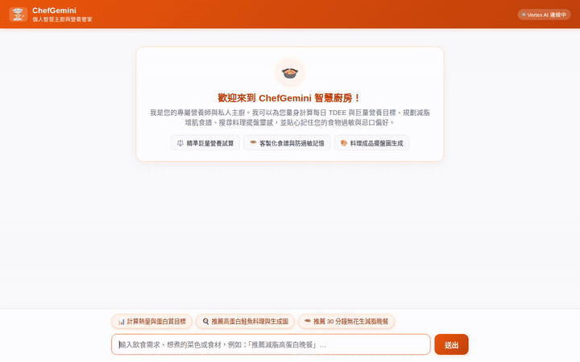

# 👨‍🍳 ChefGemini | 個人智慧主廚與營養管家

> A multimodal, agent-first culinary assistant that crafts personalized healthy recipes, calculates precision macros via code execution, remembers dietary preferences and allergens across sessions, and generates realistic dish photos and cooking videos.

<div align="center">



</div>

---

## 🌟 Overview

**ChefGemini** is built with Google's **Agent Development Kit (ADK)** and powered by **Gemini 3.8 Flash**. It moves beyond plain text advice by combining long-term memory, cloud databases, sandboxed code execution, and generative media to provide an end-to-end culinary experience: from nutrition calculations to recipe planning, local ingredient shopping, and dish visualization.

---

## 🛠️ Implemented Features & Google Cloud Services

The following capabilities and services are fully implemented and wired into the agent codebase:

### 1. 🧠 Long-Term Memory (Vertex AI Memory Bank)
- **Cross-Session Recall**: Integrated with `PreloadMemoryTool` and an automated `after_agent_callback` (`generate_memories_callback`).
- **Safety & Allergen Guardrails**: Remembers dietary preferences, health targets, and critical food allergies (peanuts, shellfish, gluten, lactose) across conversations and strictly filters future suggestions to keep users safe.

### 2. 📊 Precision Science & Calculations (Agent Engine Sandbox)
- **Python Code Execution**: Uses `AgentEngineSandboxCodeExecutor` in a secure Vertex AI Agent Engine sandbox.
- **Accurate Nutrition Planning**: Automatically runs Python scripts to calculate BMR, TDEE (Mifflin-St Jeor equation), and macro gram splits (Protein/Carb/Fat) without arithmetic hallucinations.

### 3. 🗄️ Curated Recipe Database (Google Cloud Firestore)
- **Persistent Storage**: Connected to Cloud Firestore (`recipes` collection).
- **Recipe Management**: Search, filter, inspect details (prep time, difficulty, ingredients, calories, nutrition tags), and save customized recipes.

### 4. 🎨 Generative Vision & Media (Vertex AI Imagen & Google Omni)
- **Dish Visualization**: Uses **Imagen 3** (`imagen-3.0-generate-002`) on Vertex AI to generate photorealistic plating images for custom recipes.
- **Cooking Video Generation**: Uses Google's **Omni model** (`gemini-omni-flash-preview`) in the global region to produce short videos of cooking techniques and dish preparations.
- **Cloud Storage & Artifacts**: Generated media is stored in **Google Cloud Storage** (`gs://chef-gemini-recipes-4bea0f6a`) and registered with ADK `tool_context.save_artifact` for inspection in the Playground Artifacts panel.

### 5. 🗺️ Location & Ingredients Shopping (Google Maps Platform)
- **Geocoding & Places API**: Converts street addresses to geographic coordinates and searches for nearby supermarkets and grocery stores to source recipe ingredients.

### 6. 🌐 Global Recipe Inspiration (Public API)
- **TheMealDB API**: Searches open recipe libraries worldwide for authentic culinary ideas and international dishes.

### 7. 💻 Interactive Rich UI (A2UI & Custom FastAPI Frontend)
- **Structured Cards (A2UI v0.8)**: Agent responses are formatted into flat, clean visual cards (`Card`, `Column`, `Row`, `Text`, `Image`) rendered directly in the chat UI.
- **FastAPI Chat Proxy**: A lightweight frontend talking the A2A protocol with avatar bubbles, suggested quick prompts, and responsive streaming.

---

## 📋 Planned / Roadmap (Not Yet Implemented)

- **Vertex AI RAG Engine**: Semantic grounding over external clinical nutrition whitepapers and dietary guidelines *(Planned, not yet implemented)*.
- **Pantry Inventory Manager**: Real-time CRUD tracking of items in user's refrigerator with expiration date alerts *(Planned, not yet implemented)*.

---

## 📁 Repository Structure

```
.
├── app/                        # Core ADK Agent package
│   ├── agent.py                # Main agent definition & tool registry
│   ├── a2ui_utils.py           # A2UI callback and JSON validation
│   ├── firestore_tools.py      # Firestore recipe collection operations
│   ├── image_tools.py          # Imagen 3 image generation & GCS upload
│   ├── video_tools.py          # Gemini Omni video generation & GCS upload
│   ├── maps_tools.py           # Google Maps Geocoding & Places tools
│   ├── nutrition_tools.py      # BMR / TDEE macronutrient calculations
│   └── public_api_tools.py     # TheMealDB recipe search integration
├── frontend/                   # Custom chat frontend & A2A proxy
│   ├── main.py                 # FastAPI proxy server
│   ├── Dockerfile              # Cloud Run container definition
│   └── static/
│       └── index.html          # Branded ChefGemini dialogue UI
├── demo.gif                    # Recorded screen demo of live agent interaction
├── pyproject.toml              # Project dependencies (uv)
└── agents-cli-manifest.yaml    # Agent deployment manifest
```

---

## 🚀 Getting Started Locally

### Prerequisites
- Python 3.11+
- [uv](https://docs.astral.sh/uv/) package manager
- Google Cloud SDK (`gcloud`) with active authentication

### 1. Install Dependencies
```bash
# In the agent directory:
uv sync
```

### 2. Run the Agent Playground
Start the local ADK developer playground connected to your Vertex AI Memory Bank:
```bash
uv run adk web . --port 8000 --reload_agents --memory_service_uri=agentengine://<YOUR_MEMORY_BANK_ID>
```

### 3. Run the Custom Frontend (Optional)
To run the branded chat UI locally:
```bash
cd frontend
uv venv
source .venv/bin/activate
uv pip install -r requirements.txt

export AGENT_ENGINE_RESOURCE_NAME="projects/<PROJECT_NUMBER>/locations/us-east1/reasoningEngines/<REASONING_ENGINE_ID>"
export AGENT_DIRECTORY="app"
export PORT="8080"

python main.py
```
